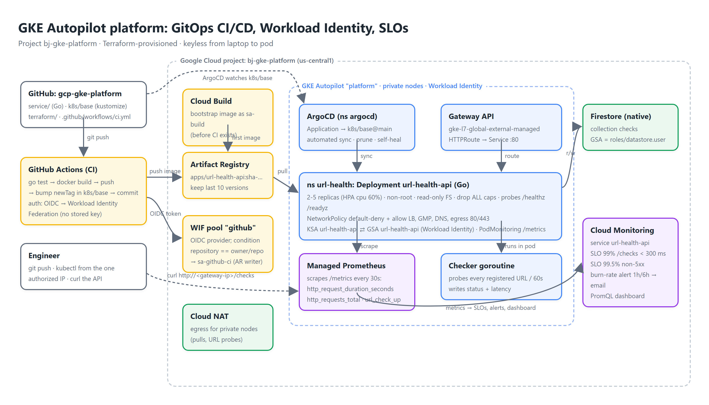

# GKE Autopilot platform: GitOps CI/CD, Workload Identity, SLOs

[](demo/demo.mp4)

A small production-style platform on **GKE Autopilot**: a Go microservice (`url-health-api`) with Prometheus metrics, **Terraform** for every cloud resource, **GitHub Actions → Artifact Registry** CI with keyless auth (Workload Identity Federation), **ArgoCD** pull-based CD from `k8s/base`, **Google Managed Prometheus**, and **Cloud Monitoring SLOs** with a multi-window burn-rate alert. Pods reach Firestore through **Workload Identity**; nothing in the pipeline holds a key.

- Demo video: [`demo/demo.mp4`](demo/demo.mp4) · captions [`demo/captions.srt`](demo/captions.srt) · transcript [`demo/transcript.md`](demo/transcript.md)
- Docs site: [`docs/index.html`](docs/index.html)
- Project: `bj-gke-platform` · region `us-central1`

## The service

`url-health-api` (Go 1.27, standard library + `prometheus/client_golang` + Firestore client):

| Endpoint | Purpose |
|---|---|
| `POST /checks` `{"url": "https://…"}` | Register a URL (validated: absolute http/https). |
| `GET /checks` | Status, HTTP code, latency and last probe time of every URL. |
| `GET /healthz` · `GET /readyz` | Liveness; readiness fails if the checker has not swept in 3 intervals. |
| `GET /metrics` | `http_request_duration_seconds`, `http_requests_total`, `url_check_up`, `url_check_latency_seconds`, `url_checks_total`. |
| `GET /version` | Build version (set with `-ldflags -X main.Version`). |

A background goroutine probes all URLs every `CHECK_INTERVAL` (60 s) with a `CHECK_TIMEOUT` (5 s), concurrently, and persists results. `STORE=memory` for local/tests, `STORE=firestore` on GKE. Unit tests cover handlers, validation, readiness and the checker (`go test ./...`).

## Architecture

```
GitHub ──push──► GitHub Actions ──OIDC/WIF──► Artifact Registry
   │                     └── commits new image tag to k8s/base/kustomization.yaml
   └──watched by──► ArgoCD (in cluster) ──sync──► Deployment / Service / HPA / NetworkPolicy / Gateway / PodMonitoring
GKE Autopilot (private nodes + Cloud NAT) ── Workload Identity ──► GSA url-health-api ──► Firestore
Managed Prometheus ──► Cloud Monitoring: custom service, 2 SLOs, burn-rate alert, dashboard
```

## Repository layout

```
service/            Go service, unit tests, multi-stage distroless Dockerfile (non-root)
terraform/          apis, vpc (+NAT), gke (Autopilot, private nodes, authorized network), registry,
                    iam (GSA + WI binding, WIF pool/provider + CI SA, bootstrap build SA), firestore,
                    monitoring (SLOs, alert policy, dashboard, email channel), outputs
k8s/base/           namespace, serviceaccount (WI annotation), deployment, service, hpa,
                    networkpolicy (default-deny), podmonitoring, gateway + httproute, kustomization
k8s/argocd/         ArgoCD Application pointing at k8s/base on main
.github/workflows/  ci.yml: test → build → push → bump tag (keyless via WIF)
cloudbuild.yaml     bootstrap build with sa-build (first image before CI exists)
deploy.sh           terraform → image → kubeconfig → ArgoCD (helm) → Application → gateway IP
demo/               recorder.py + scenes.py: automated demo video with Cloud Text-to-Speech narration
docs/               architecture diagram (HTML + PNG), docs site
```

## Deploy

```bash
cp terraform/terraform.tfvars.example terraform/terraform.tfvars   # project_id, your IP/32, alert email
./deploy.sh              # GitOps: ArgoCD syncs k8s/base from GitHub
./deploy.sh --direct     # or kubectl apply -k k8s/base (no ArgoCD), e.g. before the repo exists on GitHub
```

Then:

```bash
IP=$(kubectl -n url-health get gateway external -o jsonpath='{.status.addresses[0].value}')
curl -s -X POST http://$IP/checks -H 'content-type: application/json' -d '{"url":"https://cloud.google.com"}'
curl -s http://$IP/checks | jq
```

The first `terraform apply` reports two errors for the SLOs ("Cannot find metric"): request-based SLOs can only be created once the Prometheus series exist in Cloud Monitoring, which happens a few minutes after the app has served traffic. Run `terraform apply` again after the API has handled some requests; everything else is created on the first pass.

CI needs two GitHub secrets: `GCP_WORKLOAD_IDENTITY_PROVIDER` (Terraform output `workload_identity_provider`) and nothing else; the service account is named in the workflow. A push to `service/**` on `main` runs tests, builds `sha-<short>`, pushes it and commits the tag bump; ArgoCD applies it within its 3-minute poll (or instantly with a webhook).

## Security

- **Workload Identity:** KSA `url-health/url-health-api` ↔ GSA `url-health-api@…` (`roles/iam.workloadIdentityUser`); the GSA only has `roles/datastore.user`. No node SA keys, no JSON keys.
- **Workload Identity Federation for CI:** GitHub's OIDC token is exchanged for a short-lived token of `sa-github-ci` (`roles/artifactregistry.writer`), restricted by `attribute.repository == owner/repo`.
- **Private cluster:** private nodes, Cloud NAT for egress, control plane reachable only from `authorized_cidr`.
- **Pod hardening:** non-root (uid 65532), read-only root filesystem, all capabilities dropped, seccomp RuntimeDefault, resource limits, liveness/readiness probes.
- **NetworkPolicy:** default-deny ingress+egress; allow ingress from Google front ends and the Managed Prometheus collector only; egress to DNS and public 80/443 only.
- **Supply chain:** distroless static image, pinned Go modules, Artifact Registry retention policy.

## Observability and SLOs

- `PodMonitoring` → Managed Prometheus → metrics in Cloud Monitoring as `prometheus.googleapis.com/<metric>/<kind>`.
- Custom service `url-health-api` with two request-based SLOs (rolling 28 days):
  - **Latency:** 99% of `/checks` requests under 300 ms (distribution cut on `http_request_duration_seconds`).
  - **Availability:** 99.5% of `/checks` requests non-5xx (`http_requests_total` good/total).
- **Burn-rate alert** (OR): 1 h window > 14.4× or 6 h window > 6×, emailed through a notification channel. Those thresholds page on ~2% budget burn per hour.
- Dashboard: p99 latency, requests/s by code, URL up/down, probe latency p95 (PromQL widgets).

## Cost and cleanup

Autopilot bills per pod request (~₹100-150/day for this app + ArgoCD), the global load balancer ~₹50/day. Run it only for the demo:

```bash
terraform -chdir=terraform destroy
```

## Design notes (interview talking points)

- **Autopilot vs Standard:** per-pod billing, Google-managed nodes and upgrades, built-in Workload Identity, GMP and NetworkPolicy; you give up DaemonSets/privileged workloads and node-level tuning.
- **Pull-based GitOps:** the cluster pulls desired state; CI never needs cluster credentials. Rollback is `git revert`. Drift is corrected by `selfHeal`.
- **Why WIF over a service account key:** no long-lived secret in GitHub; tokens are minted per job and scoped to one repository by the attribute condition.
- **SLOs vs threshold alerts:** burn-rate alerts page on budget consumption rate, so a brief blip does not page but a sustained regression does; two windows balance detection time and false positives.
- **Gateway API vs Ingress:** role-oriented, standard CRDs, multi-protocol; `gke-l7-global-external-managed` gives a global external Application Load Balancer.
- **Readiness tied to the worker:** a wedged checker takes the pod out of rotation, which is a more honest signal than an always-200 health endpoint.

## How I built this

Code, Terraform and the demo pipeline were written with Claude Code and verified against the real project: `go test`, `terraform validate`/`apply`, live curl against the Gateway, ArgoCD sync, and the SLO pages in Cloud Monitoring.
